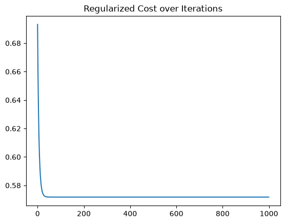

# ML From Scratch

Linear and logistic regression implemented in NumPy, with no ML libraries.

## What's inside
- Gradient descent
- Vectorized implementation
- Logistic regression with L2 regularization
- Cost curve plotting

## Run
Open `logistic_regression_from_scratch.ipynb` and run all cells.